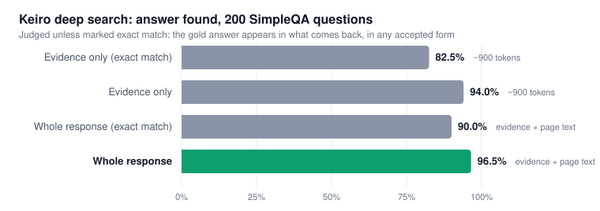

# Keiro deep search on SimpleQA

A benchmark of Keiro's deep search endpoint, `POST /api/v2/deep`, on 200 SimpleQA questions. Deep searches several engines, reads the top pages, scores passages for how likely they are to hold the answer, and returns the best ones packed into a token budget. The runner is [`bench_deep.py`](bench_deep.py), and every question's result is in [`results/deep_200.json`](results/deep_200.json).



**The answer is in deep's response for 193 of 200 questions (96.5%), and in the ~900-token evidence alone for 188 (94.0%).**

## Results

| | Answer found | Exact match |
|---|---|---|
| **Evidence only** (~900 tokens, what an agent reads) | **94.0%** (188/200) | 82.5% (165/200) |
| **Whole response** (evidence + page text) | **96.5%** (193/200) | 90.0% (180/200) |

*Answer found* is exact match plus the judged variant forms (see [Scoring](#scoring)).

| | |
|---|---|
| Evidence size | 896 tokens on average (budget 1,000) |
| Latency | median 7.5 s, 90th percentile 18.1 s |
| Stopped early | 143 of 200 calls (median 6.3 s): two independent sites agreed, so it stopped reading |
| Best page ranked first | 154 of 200 |
| Price | 5 credits per call on every plan |

### Does `answer_status` mean what it says?

Every response says whether it found the answer: `found`, `weak` or `not_found`.

| Status | Calls | Answer in the evidence |
|---|---|---|
| `found` | 188 | 183 (97.3%) |
| `weak` | 6 | |
| `not_found` | 6 | |

An agent can trust `found` and spend its effort on the other 12.

## Compared with Lite

The same scoring on Lite, in its [open benchmark](https://github.com/Keirolabs-API/lite-search-benchmark) (500 different SimpleQA questions, so compare the levels, not single questions):

| | Answer found | Tokens to read |
|---|---|---|
| Lite results only | 59.4% | ~550 |
| Lite + top 5 pages crawled | 84.6% | ~13,800 |
| Lite + an open recipe, top 8 pages crawled | 92.0% | ~37,000 |
| Lite + recipe, then BM25 picks ~900 tokens | 75.6% | ~900 |
| **Deep, evidence only** | **94.0%** | **~900** |

At the same ~900 tokens, keyword picking keeps the answer 75.6% of the time and deep's passage scoring keeps it 94.0%.

## The 7 misses

| Question | Gold answer | Status |
|---|---|---|
| Square footage of the State Hermitage Museum's gallery space | 719,480 square feet | found |
| When, where and by whom IFK was founded | 1 February 1895, Stockholm, Louis Zettersten and Pehr Ehnemark | found |
| Who cheated in the 1993 Comrades Marathon | Herman Matthee | found |
| Release date of Aseprite v1.3-beta1 | May 26th, 2021 | not_found |
| Year the People's Action Committee was established in Kashmir | 1963 | weak |
| Date women were welcomed into the United States Polo Association | 1 January 1972 | not_found |
| Subject Mary Winifred Betts lectured on at Otago University | Botany | found |

Most are pages that don't load or don't exist in readable form, compound answers with one part missing, or numbers stated in other units.

## Scoring

- **Exact match:** the gold answer, lowercased with punctuation and articles removed, is a substring of the text.
- **Answer found:** exact matches, plus misses that an LLM judge (`google/gemini-3.1-flash-lite`) accepts. The judge reads the text around the gold answer's rarest words. It counts variant forms: date order, abbreviations, numerals vs words, transliterations, paraphrases, and compound answers with every part stated. It does not count answers you would have to compute, partial answers or different values. Its prompt is in `judge()`.

This measures whether the answer is **present** in what comes back, not whether a model reading it would answer correctly.

## Sample

200 questions from [OpenAI's SimpleQA test set](https://openai.com/index/introducing-simpleqa/): `random.seed(42)`, then `random.sample(rows, 500)[300:500]`. None of them were used while building or tuning deep.

## Run it

```bash
pip install -r requirements.txt
export KEIRO_API_KEY=...        # platform.keirolabs.cloud
export OPENROUTER_API_KEY=...   # runs the judge
python bench_deep.py
```

The SimpleQA CSV downloads on first run. Each question is one deep call (5 credits).

| Variable | Default | |
|---|---|---|
| `N`, `OFFSET` | 200, 300 | Which questions |
| `BUDGET` | 1000 | Evidence token budget |
| `CONC` | 3 | Questions in parallel |
| `JUDGE_MODEL` | `google/gemini-3.1-flash-lite` | Any OpenRouter model |
| `BASE` | `https://api.keirolabs.cloud/api/v2` | |
| `OUT` | `results.json` | |

## Files

- [`bench_deep.py`](bench_deep.py): the runner and the judge
- [`results/deep_200.json`](results/deep_200.json): every question with its verdicts, status, confidence, evidence (first 600 characters per passage), tokens and latency
- [`assets/headline.svg`](assets/headline.svg): the chart above

## License

MIT. SimpleQA is © OpenAI, MIT-licensed.
